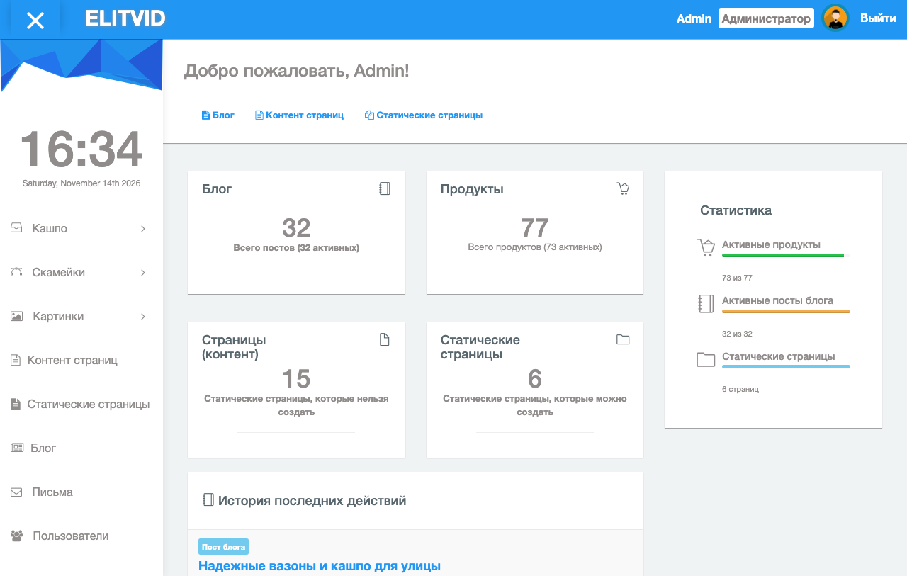

# Админка

Админка открывается после входа на `/login`. В меню: кашпо по формам, скамейки по коллекциям, картинки страниц, контент страниц, статические страницы, блог, письма и пользователи.

Главная админки показывает числа: посты блога, товары, страницы и последние изменённые записи. В локальной базе один пользователь, и его роль — администратор. Роли менеджера и обзорного в коде есть, отдельных учёток под них сейчас нет.

## Кто что может

Войти в админку могут все три роли. Дальше права расходятся.

| Действие | Администратор | Менеджер | Обзорный |
|---|---|---|---|
| Смотреть сводку, каталог, блог, страницы, картинки | да | да | да |
| Создавать и сохранять товары, посты, страницы, тексты и картинки | да | да | нет |
| Открыть письма | да | да | нет |
| Удалять товар, пост, страницу или картинку | да | нет | нет |
| Заводить пользователей и менять им роль | да | нет | нет |

Если действие закрыто, человек остаётся на той же странице и видит сообщение, что для его аккаунта оно недоступно.

## Каталог

Скамейки разложены по коллекциям Verona, Stones, Solo, Lines и Street furniture. Кашпо — по круглым, квадратным и прямоугольным. Карточка общая для обоих типов: название, ссылка, активность и текст для поиска. У скамейки дополнительно коллекция, материал и свой набор полей. Картинки изделия крепятся к карточке.

Скрытый товар на сайте не показывается. Удаление карточки доступно только администратору.

## Картинки страниц и контент

Это не каталог.

«Контент страниц» правит заголовок, описание для поиска и текст у страниц, которые перечислены в `config/pages.php`. Новую страницу здесь не создают. В базе 15 таких записей, по одной на ключ: главная, направления, декор, блог, скамейки, кашпо, болларды и коллекции.

«Картинки страниц» меняют изображения тех же экранов и ещё тех направлений, которые заведены как статические страницы. Набор страниц в меню картинок шире, чем список ключей контента: туда входят фасад, парклеты, столбы, ротонды и малые формы.

## Статические страницы

Это страницы, которые можно создать. У каждой есть название в меню, адрес, заголовок, текст и признак активности. Активная страница появляется в меню направлений и открывается по своему адресу. Сейчас таких страниц шесть, все активны.

Обзорный пользователь может открыть список. Сохранять может менеджер и администратор. Удалять — только администратор.

## Блог и письма

Блог в админке — те же посты, что на сайте. Правила ролей те же, что у статических страниц: смотреть могут все, писать — администратор и менеджер, удалять — администратор.

Письма — заявки с сайта. Раздел виден администратору и менеджеру. Как устроена форма, описано в `zayavki.md`.

## Пользователи

Раздел пользователей виден только администратору. Он задаёт роль: администратор, менеджер или обзорный. Остальные роли этот раздел не открывают.
