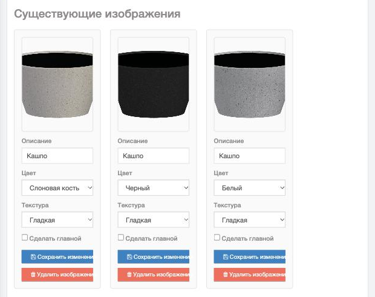
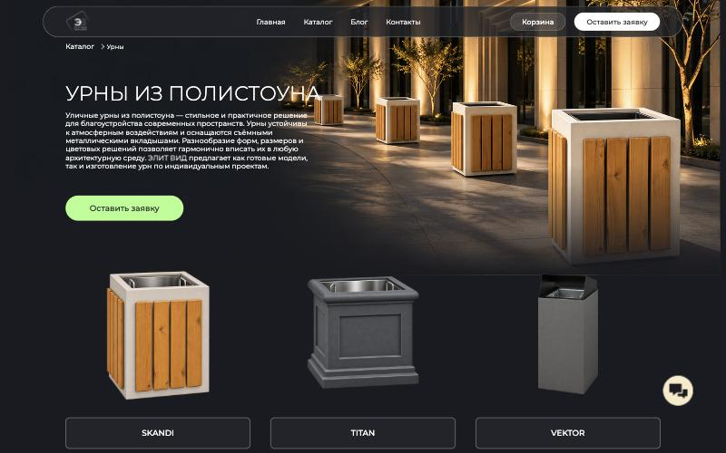

# Каталог

Каталог — это товары трёх типов: скамейки, кашпо и урны. Общая карточка товара хранит название, адресную часть ссылки, тип, признак «показывать на сайте» и текст для поиска. Детали скамейки, кашпо и урны лежат в своих таблицах и связаны с этой карточкой.

В локальной базе 50 скамеек, 27 кашпо и 5 урн. Скрыто 9 скамеек и 3 кашпо. Все урны активны.

Скрытый товар не попадает в публичные списки. Страница самого товара по прямой ссылке отвечает «Страница не найдена» (404) любому посетителю, в том числе вошедшему в админку. Предпросмотра скрытого товара нет.

Карточку скамейки, кашпо или урны посетитель может добавить в корзину. Как работает корзина, описано в `zayavki.md`.

## Главная картинка товара

У каждого товара одна главная картинка. Её видно в карточке товара в каталоге и в блоке «похожие товары» на странице другого товара. Страница самого товара открывается на ней же, а переключатели фактуры и цвета сначала стоят на её фактуре и цвете. Если у главной картинки фактура или цвет не заданы, переключатель стоит на мраморе и слоновой кости, как раньше.

Главную выбирают в админке чекбоксом «Сделать главной». Он есть у каждой картинки в форме правки товара и у каждой загружаемой картинки в форме создания и дозагрузки. Отметка одной картинки снимает отметку с остальных.

Если ни одна картинка не отмечена, главной считается загруженная первой. Поэтому у товара с одной картинкой она главная без отметки. Если удалить главную картинку, главной становится загруженная первой из оставшихся.

Сейчас в базе у всех 27 кашпо главная — пористая картинка цвета «слоновая кость». У скамеек и урн отметок нет: у каждой одна картинка, она и главная.

## Скамейки

Список скамеек открывается из меню направлений. У скамейки есть коллекция. На сайте и в админке коллекции разделены:

| Коллекция | Записей в базе | Из них активных |
|---|---|---|
| Lines | 18 | 18 |
| Stones | 17 | 15 |
| Solo | 10 | 5 |
| Verona | 3 | 3 |
| Street furniture | 2 | 0 |

Коллекцию Street furniture с сайта убрали. Адрес `/napravleniya/skami/street-furniture` постоянно перенаправляет на общий список скамеек. Старый адрес товара этой коллекции ведёт на тот же товар в Lines, если он там есть, иначе на список скамеек. В админке пункт Street furniture остался.

Карточка скамейки дополнительно хранит материал и набор полей в JSON. Картинки товара прикрепляются к карточке. Отдельные картинки шапки и списков коллекций правятся не в карточке товара, а в разделе картинок страниц.

Скрытая скамейка в публичный список не попадает.

## Кашпо

Кашпо делятся на две формы: круглые и «квадратные и прямоугольные». У каждой формы свой список на сайте (`/napravleniya/kashpo/kruglye` и `/napravleniya/kashpo/kvadratnye-i-pryamougolnye`) и свой пункт в админке. Карточка кашпо связана с общим товаром так же, как скамейка.

Раньше квадратные и прямоугольные кашпо были отдельными направлениями. Старые адреса `/napravleniya/kashpo/kvadratnye` и `/napravleniya/kashpo/pryamougolnye`, вместе с адресами их товаров, постоянно перенаправляют на объединённое направление.

Картинки витрины форм правятся в картинках страниц. Фото конкретного изделия — у карточки товара.

В базе 22 круглых кашпо (активных 19) и 5 квадратных и прямоугольных (активны все).

## Урны

Урны открываются по адресу `/napravleniya/urny`. Это отдельное направление со своим списком без деления на коллекции. В список попадают только активные урны, новые сверху. Под списком — текст категории и блок «Примеры работ», если галерея страницы включена. Текст, описание для поиска и галерея правятся в «Контенте страниц» по ключу `urns`.

Страница урны открывается по адресу `/napravleniya/urny/{slug}`. Фактуры и цвета на ней те же, что у кашпо: их подписи берутся из «Картинки страниц › Страница товара кашпо». Внизу — другие активные урны в случайном порядке.

Карточка урны хранит материал и варианты (размер, вес, цена), как у кашпо. Коллекции у урны нет. При создании нужно загрузить хотя бы одну картинку.

В админке у урн отдельный пункт меню «Урны». Создание и правка идут через ту же общую форму товара.

## Болларды и ограждения

Страница боллардов и ограждений — отдельное направление, не товарный список скамеек или кашпо. Её текст и картинки меняются как у фиксированной страницы: контент страницы и картинки с ключом `bollards_and_fencing`. Новую такую страницу из админки не создают.
