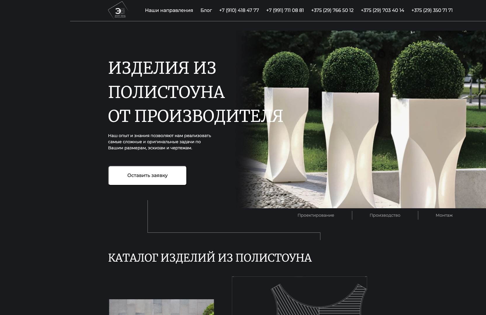

# Сайт Elitvid

Публичный сайт показывает изделия и направления компании. Меню в шапке ведёт на «Наши направления» и «Блог». В подвале продублированы кашпо, скамьи, болларды и список страниц, которые заведены в админке.

Адрес локально: http://localhost:8080.

## Главная

Главная страница собирается из фиксированного шаблона и контента, который правится в админке: заголовок для поиска, описание и картинки блока «Главная страница». Сама страница в админке не создаётся как новая запись. Её ключ — `main` в `config/pages.php`.

## Направления

Раздел «Наши направления» собирает каталоги и отдельные страницы.

Часть страниц зашита в коде и в `config/pages.php`: скамейки, кашпо, болларды и ограждения, декоративные элементы, коллекции скамеек и формы кашпо. Текст и картинки этих страниц меняются в админке, но новую такую страницу кнопкой «создать» не добавляют. Для неё нужен ключ в конфиге и маршрут.

Другая часть создаётся в админке как статическая страница. Она открывается по адресу `/napravleniya/{slug}` и попадает в меню под своим коротким названием. Сейчас в базе шесть активных страниц: малые архитектурные формы, фасадная лепнина и панели, парклеты и навесы, столбы и накрывки, ротонды и колонны, изделия из бетона.

Неактивная статическая страница на сайте не показывается: контроллер берёт только записи с признаком активности.

## Как контент попадает на сайт

У фиксированной страницы два независимых слоя.

Контент страницы хранит заголовок и описание для поиска и текст категории. Список таких записей совпадает с ключами из `config/pages.php`. В локальной базе их 15.

Картинки страницы хранятся отдельно и привязаны к имени страницы: главная, коллекции, формы кашпо, болларды, декор и те же направления, что заведены как статические страницы.

Товар каталога — отдельная запись. Пока товар не отмечен активным, в публичный список он не входит. В локальной базе 46 активных скамеек, 4 неактивных скамейки и 27 активных кашпо.

## Заявка

На страницах есть форма обратной связи. Что с ней происходит, описано в `zayavki.md`.

