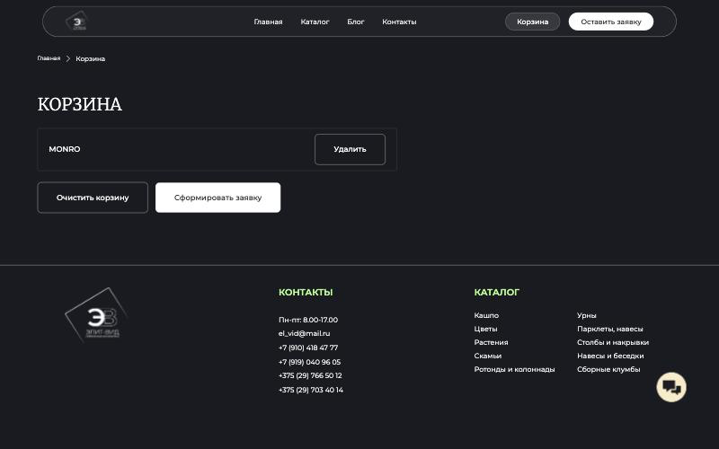

# Заявки

Посетитель обращается двумя путями: форма обратной связи со страницы сайта и заказ из корзины. Отдельного личного кабинета у него нет.

## Что спрашивает форма

Обязательны имя, почта и телефон. Название организации и текст сообщения можно не заполнять. К заявке можно приложить один файл не больше 512 КБ. Форма не уходит без проверки «я не робот».

Телефон перед проверкой очищается от всего, кроме цифр. Принимаются номера белорусских операторов (29, 33, 44, 25 и ещё семь цифр) и номера, которые начинаются на 9 или 7 и содержат десять цифр. Другой набор цифр форма отвергает с текстом «Неверный формат номера телефона».

## Куда девается заявка

После успешной отправки происходят две записи одного и того же обращения.

Письмо уходит на адрес, который указан прямо в коде приёма формы. Туда же уходит вложение, если оно было.

Та же заявка сохраняется в базе: имя, почта, телефон с кодом страны, организация, текст и путь к файлу. В локальной базе 31 такая запись. Админка на главной строит по ним график за последние восемь недель.

## Кто видит заявки

В админке раздел называется «Письма». Его открывают администратор и менеджер. Обзорный пользователь в этот раздел не входит: маршрут для него закрыт.

Скачивание вложения идёт отдельной ссылкой на файл из хранилища. Сам файл в репозиторий не входит: при локальном запуске его нужно скопировать с хостинга в `storage/app/public/`.

## Заказ из корзины

На странице скамейки, кашпо или урны есть кнопка «Добавить в корзину». Если товар уже лежит в корзине, вместо неё стоит «Удалить». Добавить можно только активный товар. Количество не ведётся: товар в корзине либо есть, либо нет.

Корзина хранится в сессии браузера. Аккаунт для неё не нужен. Если закрыть сессию, корзина пропадает.

Страница корзины — `/cart`. В ней список товаров, у каждого кнопка «Удалить», и кнопка «Очистить корзину». Если товар после добавления скрыли или удалили, строка показывает «Товар недоступен» и просит убрать его. Пока такая строка есть, кнопки «Сформировать заявку» нет.

«Сформировать заявку» открывает форму с теми же полями и проверками, что у обычной заявки: имя, почта и телефон обязательны, организация и комментарий нет. Комментарий — до 100 символов. Отправка проходит проверку «я не робот». Файл приложить нельзя.

После отправки заказ и список его товаров сохраняются в базе, а в журнал приложения пишется строка с данными заказа. Затем уходит письмо «Заказ из корзины #N» на тот же адрес, что у формы заявки. В письме имя, почта, телефон, организация, комментарий и названия товаров. Пустые поля заменены прочерком. Корзина очищается, а посетитель видит «Заявка принята.».

Если письмо отправить не удалось, заказ всё равно остаётся в базе, корзина очищается, а посетитель видит то же «Заявка принята.». Ошибка отправки пишется в журнал, а заказ получает отметку, что письмо не ушло. В локальной базе заказов пока нет.

## Заказы в админке

Раздел «Заказы» открывают администратор и менеджер. Обзорному пользователю маршрут закрыт.

Таблица показывает дату, имя, почту, телефон, организацию, комментарий и товары заказа, новые сверху, по 20 на странице. Если письмо по заказу не ушло, под датой стоит красная пометка «Письмо не отправлено». Тогда менеджеру нужно связаться с клиентом самому. У заказов, созданных до появления письма, пометки нет. Список можно сузить по датам «С» и «По». Кнопка «Скачать CSV» выгружает те же заказы с тем же фильтром в файл `orders.csv`. Разделитель в файле — точка с запятой.
